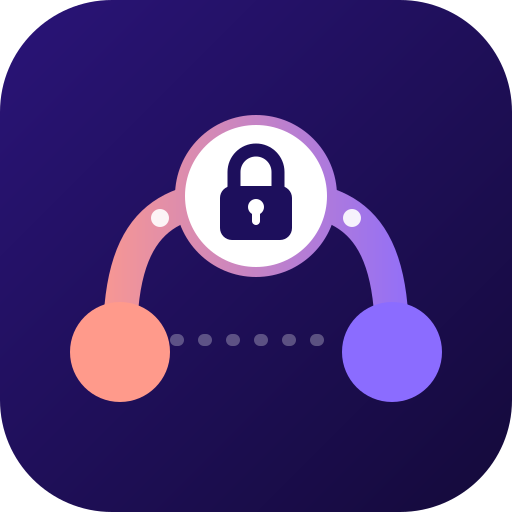

<a href="https://mumcord.app/en">
  <picture>
    <source media="(prefers-color-scheme: dark)" srcset="banner.png">
    <source media="(prefers-color-scheme: light)" srcset="banner-light.png">
    
  </picture>
</a>

<p align="center">
  <b>Mumcord is a modern voice and chat client for any standard Mumble server.</b><br>
  Client only: nothing to install or change on the server. Open source, no telemetry, made in the EU.
</p>

<p align="center">
  <a href="https://github.com/Mumcord/mumcord/releases/latest"></a>
  <a href="https://github.com/Mumcord/mumcord/releases/latest"></a>
  <a href="https://mumcord.app/en"></a>
</p>

## The family

<table>
  <tr>
    <td width="50%" valign="top">
      
      <b><a href="https://github.com/Mumcord/mumcord">Mumcord</a></b><br>
      <sub>The desktop app</sub>
      <br clear="left">
      <p>Voice and chat for Mumble that feels current: several servers at once, text channels, replies and history sync, themes, an in-game overlay, watch parties and screen sharing.</p>
      <a href="https://github.com/Mumcord/mumcord/releases/latest">Download</a> ·
      <a href="https://github.com/Mumcord/mumcord/wiki">Wiki</a> ·
      <a href="https://mumcord.app/en">Website</a>
    </td>
    <td width="50%" valign="top">
      
      <b><a href="https://github.com/Mumcord/mumbot">mumbot</a></b><br>
      <sub>Bots for any Mumble server</sub>
      <br clear="left">
      <p>One small binary or Docker image with bot modules: <code>webhook</code> posts alerts and CI results, <code>peer</code> announces a mumpeer relay, <code>history</code> keeps chat for offline users, <code>music</code> plays MP3s into a channel.</p>
      <a href="https://github.com/Mumcord/mumbot/releases/latest">Releases</a> ·
      <a href="https://github.com/Mumcord/mumbot/tree/main/docs">Docs</a> ·
      <a href="https://mumcord.app/en/mumbot">Website</a>
    </td>
  </tr>
  <tr>
    <td width="50%" valign="top">
      
      <b><a href="https://github.com/Mumcord/mumpeer">mumpeer</a></b><br>
      <sub>Peer-to-peer relay</sub>
      <br clear="left">
      <p>A small relay that a community runs next to its Mumble server. Screen sharing and full-size images still get through NAT, CGNAT and strict firewalls, end-to-end encrypted, without revealing anyone's IP address.</p>
      <a href="https://github.com/Mumcord/mumpeer/releases/latest">Releases</a> ·
      <a href="https://github.com/Mumcord/mumpeer/tree/main/docs">Docs</a>
    </td>
    <td width="50%" valign="top">
      <b><a href="https://github.com/Mumcord/rnnoise-rs">rnnoise-rs</a></b><br>
      <sub>Noise suppression in pure Rust</sub>
      <p>A dependency-free Rust port of the current RNNoise model, at parity with the C reference and faster than it. It powers the noise suppression in Mumcord.</p>
      <a href="https://github.com/Mumcord/rnnoise-rs">Repository</a> ·
      <a href="https://github.com/Mumcord/rnnoise-rs/tree/dev/doc">Docs</a>
    </td>
  </tr>
</table>

## Get Mumcord

- **Windows, macOS, Linux:** installers, `.deb`, `.rpm` and AppImage in the [latest release](https://github.com/Mumcord/mumcord/releases/latest).
- **Linux in one line:**

  ```sh
  curl -fsSL https://github.com/Mumcord/mumcord/releases/latest/download/install.sh | sh
  ```

- **Arch Linux:** `mumcord-bin` from the AUR.
- **No server yet?** The [server guide](https://mumcord.app/en/server) sets one up with Docker in a few minutes.

## Get involved

- Guides and answers: the [Mumcord wiki](https://github.com/Mumcord/mumcord/wiki)
- Something broke? [Report a bug](https://github.com/Mumcord/mumcord/issues/new?template=bug_report.yml)
- An idea? [Request a feature](https://github.com/Mumcord/mumcord/issues/new?template=feature_request.yml)
- Want to help build it? Read the [contributing guide](https://github.com/Mumcord/mumcord/blob/main/CONTRIBUTING.md)
- What's next: the [roadmap](https://mumcord.app/en/roadmap)

## Licence

Mumcord, mumbot and mumpeer are free software under the [AGPL-3.0](https://github.com/Mumcord/mumcord/blob/main/LICENSE). rnnoise-rs is under the [BSD-3-Clause licence](https://github.com/Mumcord/rnnoise-rs/blob/dev/LICENSE) of RNNoise.

<sub>Mumcord is compatible with Mumble but is neither affiliated with nor endorsed by the Mumble project.</sub>
